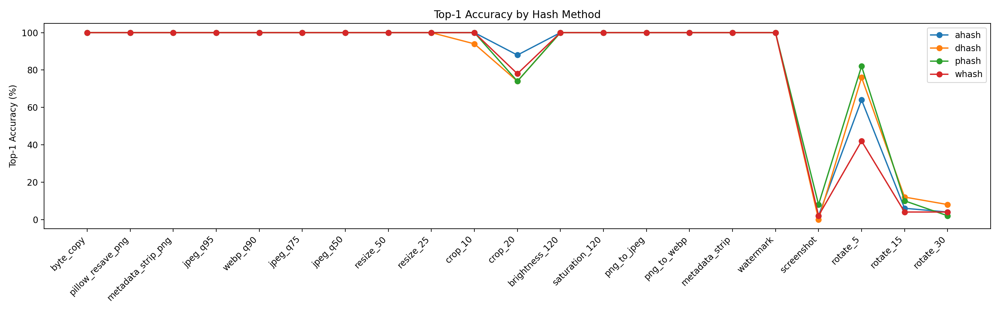

# 게임 이미지 에셋 검증, WISA 2026

<!-- portfolio-languages -->
[](README.md) [](README.ko.md) [](README.ja.md)
<!-- /portfolio-languages -->

**WISA 2026: 제1저자, 포스터 발표**

[제27회 World Conference on Information Security Applications](https://wisa.or.kr/)

2026.08.26 ~ 28, 제주 메종 글래드

## 방법과 결과 요약

게임 이미지 50개에 변형 17종과 대조군 5종을 적용한 기록으로, C2PA 검증 1,150건과 해시 평가 4,400행을 제공합니다. 20% 잘라내기의 Top-1 검색은 74~88%, 합성 스크린샷 캔버스 조건은 0~8%였습니다. 성공뿐 아니라 실패 조건을 분석한 연구입니다. 공개 자료에는 스크립트, 측정 CSV, 논문, 포스터가 있으며 원본 이미지 전체와 서명 키는 포함하지 않습니다.

## 연구 자료 읽는 순서

연구 질문과 방법을 먼저 읽고, 측정 결과와 실패 사례를 확인하세요. 재현 안내에서 공개된 산출물과 별도로 필요한 로컬 데이터를 구분할 수 있습니다.

[개발 사례 보기](https://ysl-ryudo.github.io/ko/research/wisa/), [Portfolio](https://ysl-ryudo.github.io/ko/)

**A Verification Method for Game Image Assets Using C2PA Manifest Validation and Perceptual Hash-Based Similarity Analysis**의 연구 코드와 기록된 실험 결과입니다.

**WISA 2026, 대한민국 제주 포스터 발표.** 이영상은 제1저자이자 포스터 발표자입니다. 공동 연구이며 MOD 패키지 provenance 연구 및 GCTLAB 개발과 별개입니다.

## 연구 질문과 방법

게임 이미지가 재저장, 변형된 뒤에도 출처 정보와 원본 후보를 확인할 수 있는가?

1. C2PA Manifest 존재 여부, 서명과 콘텐츠 해시를 검증합니다.
2. 64비트 aHash, dHash, pHash, wHash로 기준 이미지와 비교합니다.
3. Top-1, Top-3 검색 성능과 실패 조건을 기록합니다. 유사도는 보조 증거이며 소유권 증명이 아닙니다.

보존한 v3 코드는 대조군, 변형 이미지 전체의 해시를 평가하며, C2PA 결과에 따라 분기하는 상용 서비스를 구현한 것은 아닙니다. 테스트 인증서의 신뢰 경고와 서명, 데이터 해시 실패를 구분합니다.

## 기록된 실험

연구용 이미지 50개에 변형 17종(850개), 대조 조건 5종(250개)을 적용했습니다. C2PA 검증은 **1,150개 파일**, 해시 평가는 **1,100개 질의 × 4종 = 4,400행**입니다.

| 조건 | 기록된 Top-1 결과 |
|---|---:|
| JPEG Q95, 50% 축소, 메타데이터 제거, 워터마크 | 네 해시 모두 100% |
| 20% 크롭 | 74~88% |
| 스크린샷 모사 캔버스 | 0~8% |
| 5° 회전의 pHash | 82% |
| 15°, 30° 회전 | 모든 방법 12% 이하 |

서명 원본과 바이트 복사는 유효한 claim을 유지했지만 다른 대조군과 변형본에서는 검출되지 않았습니다. 스크린샷 조건은 축소 이미지를 배치한 1920×1080 합성 캔버스이며 모든 화면 캡처 앱을 측정한 것이 아닙니다. 결과의 범위는 이 50개 이미지 데이터셋입니다.



## 재현과 확인

코드와 측정 CSV를 포함합니다. 원본, 서명 이미지 데이터와 비공개 서명 키는 **포함하지 않으므로**, 이 저장소만으로 전체 실험을 재실행할 수는 없습니다. 대응하는 서명 이미지는 `experiment/data/signed/<asset_type>/`에 배치하세요. 원래 서명 단계는 `scripts/01_embed_c2pa.py`에 보존했으며 저장소 루트의 `metadata/assets.csv`, `data/original/`과 설정된 c2patool 서명 환경이 필요합니다.

격리된 환경에서 `requirements.txt`를 설치하고 c2patool을 준비하세요. 로컬 보관본에는 v0.26.50이 있습니다.

```sh
python scripts/wisa_originality_v3_all.py --root ./experiment --c2patool c2patool
```

새 실험 디렉터리에서 실행하세요. 스크립트는 그곳에 변형 이미지와 결과를 씁니다. 보존된 `results/`는 유지하세요. 복구한 requirements에는 정확한 Python 패키지 버전이 고정돼 있지 않습니다.

패키징 과정에서 ZIP 무결성, Python 문법, 결과 행 수, 논문 주요 수치 일치를 확인했지만 이미지 실험을 재실행하지는 않았습니다. CSV 사본의 컴퓨터별 경로를 상대 경로로 바꿨고 v3 코드에서는 설명 문자열의 경로 예시만 수정해 실행 알고리즘은 보존했습니다.

## 논문, 포스터, 저자

[논문](paper/WISA_2026_paper.pdf), [포스터](paper/WISA_2026_poster.pdf), [기록된 결과](results/), [자료 해시](ARTIFACTS.sha256)

Young-Sang Lee, Jung-Min Park, Won-Yong Lee, Geon Park, Myeong-Jae Lee, Yun-Ho Kim, Jung-Guen Lee, Dang Dai Tho, Hye-Young Kim. 전체 소속, 연구비 사사, 참고문헌은 논문에 보존돼 있습니다. 논문, 이미지, 외부 도구 전체에 임의의 통합 라이선스를 부여하지 않습니다.
